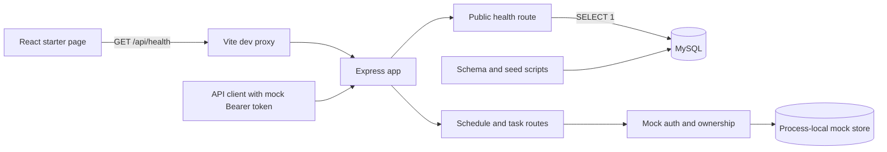

# Architecture and Implementation Notes

Reviewed November 14, 2026. This guide describes the code that exists today. The [SRS](SRS.md) defines the target product, and the [backend plan](BACKEND_TASKS.md) tracks unfinished work.

## Workspace layout

```text
.
├── apps/
│   ├── api/
│   │   ├── src/
│   │   │   ├── app.ts                 Express app and middleware
│   │   │   ├── server.ts              Environment, DB check, listener, shutdown
│   │   │   ├── db/pool.ts             Lazy MySQL pool and connectivity helpers
│   │   │   ├── lib/errors.ts          HTTP errors, async wrapper, error middleware
│   │   │   ├── lib/validate.ts        Zod parsing and request helpers
│   │   │   ├── mocks/auth.ts          Temporary fixed Bearer identities
│   │   │   ├── mocks/data.ts          In-memory children, activities, schedules, tasks
│   │   │   └── routes/
│   │   │       ├── health.ts          Live MySQL connectivity
│   │   │       ├── schedules.ts       Mock-backed schedule handlers
│   │   │       ├── schedules.test.ts  Schedule route tests
│   │   │       ├── tasks.ts           Mock-backed task handlers
│   │   │       └── tasks.test.ts      Task and lifecycle tests
│   │   ├── scripts/schema.ts         Apply SQL statements
│   │   ├── scripts/seed.ts           Seed SQL development data
│   │   ├── schema.sql                Seven-table definition
│   │   ├── .env.example
│   │   └── vitest.config.ts
│   └── web/
│       ├── src/App.tsx               Starter page and health status
│       ├── src/lib/api.ts            Typed health fetch helper
│       ├── src/main.tsx              React StrictMode entry point
│       ├── src/styles.css
│       ├── .env.example
│       ├── index.html
│       └── vite.config.ts            React plugin and development proxy
├── packages/shared/src/
│   ├── index.ts                      HealthResponse and schema re-exports
│   └── schemas.ts                    Zod enums and schedule/task input schemas
├── scripts/
│   ├── install-hooks.mjs             Explicit Git hook installer
│   └── git-hooks/commit-msg          Conventional Commits subject validation
├── docs/
├── package.json                      Workspace orchestration
├── package-lock.json                 Locked dependencies
└── tsconfig.base.json                Shared strict TypeScript settings
```

Each workspace also has its own `package.json` and `tsconfig.json`. Names are `@starter/web`, `@starter/api` and `@starter/shared`; the repository is not using a separate monorepo orchestration tool.

## Current runtime flow



The two stores have no synchronization path. A healthy database does not mean schedule/task requests are persisted. The current browser page calls only health; it has no schedule, account, child, card, progress or settings screens.

### API process and middleware

[server.ts](../apps/api/src/server.ts) loads environment variables, validates the listener port, checks MySQL connectivity and then opens the HTTP listener. Failed connectivity exits startup. On SIGINT/SIGTERM it closes the listener and pool; a ten-second fallback exits if shutdown does not finish.

[app.ts](../apps/api/src/app.ts) is importable without opening the listener or connecting to MySQL. It disables `x-powered-by` and mounts, in order:

1. CORS using one configured frontend origin.
2. JSON parsing with a `100kb` limit.
3. Health, schedule and task routers.
4. JSON 404 fallback.
5. Central error handling.

Schedule/task routers apply mock authentication before their handlers. They validate input with shared schemas, perform ownership checks through the child's owner, and use the in-memory data module. Feature errors use `{ "error": "message" }`; health returns its own typed 200/503 object. CORS determines browser response access and is not a substitute for authentication.

### Web client

[App.tsx](../apps/web/src/App.tsx) calls `getHealth` on mount and aborts that request during cleanup. It displays the health message on success and a plain error message if the request fails. The client treats any non-2xx response, including health 503, as a failure.

[api.ts](../apps/web/src/lib/api.ts) prepends `VITE_API_BASE_URL` when set, otherwise uses same-origin `/api/health`. The TypeScript response type is not a runtime response validator. Vite's `server.proxy` forwards development requests only; the static build and preview require their own API routing or an explicit API base URL.

### Shared contracts and builds

The shared package exports Zod schemas at runtime and `HealthResponse` as a TypeScript interface. Schedule/task resource interfaces currently live in `mocks/data.ts`; they have not been promoted to shared client contracts. Authentication, children, cards, progress and settings do not yet have request schemas or response contracts.

The root build runs **shared → API → web**. The shared package's runtime export resolves to `dist/index.js`; its types resolve to source. API development and tests build shared first, but changing a shared source file during an already-running API watcher requires rebuilding shared. `npm start` runs the compiled API only.

TypeScript uses strict checks and `noUncheckedIndexedAccess`. API/shared use NodeNext ES modules; web uses bundler resolution. There is no lint script, CI workflow or hosting configuration in the reviewed repository.

## Database foundation

[pool.ts](../apps/api/src/db/pool.ts) lazily creates a `mysql2/promise` pool, with a connection limit of ten and waiting enabled. Database host, port, user and name must be nonempty; password must be defined but may be empty. No database is created by the application. See [environment configuration](../README.md#environment-variables).

### Tables and relationships

| Table | Ownership / constraints | Relevant defaults |
| --- | --- | --- |
| `users` | Unique email; role enum; owns children and one settings row | Creation timestamp; password hash nullable for SQL demo fixture |
| `children` | Required owner FK; deleting owner cascades | Avatar; creation timestamp |
| `activities` | Unique name; category enum; shared library | No per-user owner |
| `schedules` | Required child FK; unique child/date; child deletion cascades | Creation timestamp |
| `tasks` | Required schedule FK; unique schedule/position; schedule deletion cascades; activity deletion sets reference to null | Pending status; nullable time/duration/completion |
| `picture_cards` | Null child for shared defaults; owned child for custom cards; child deletion cascades | Creation timestamp; no hidden flag |
| `settings` | Owner FK and primary key; owner deletion cascades | Medium font, normal contrast, sounds on |

Tables use InnoDB and `utf8mb4_unicode_ci`. The schema has no migration history. It does not enforce every API validation rule, such as the 1–1440 duration range.

`scripts/schema.ts` reads `schema.sql`, splits on semicolons, and applies the seven statements sequentially. Re-running creates missing tables but does not alter existing definitions. The statements are not wrapped in a migration transaction; a failure may leave earlier tables created. Schema changes need an explicit migration approach rather than assuming this command upgrades existing databases.

### SQL demo seeding

`scripts/seed.ts` runs within one transaction and rolls back on failure. It:

- Upserts 11 activities by unique name, refreshing their icons and categories.
- Inserts ten shared default cards when a matching category/label does not exist.
- Creates or reuses `demo@special-project.invalid`, with a null password hash when newly inserted.
- Creates or reuses Avery (speech), Jordan (motor) and Riley (social).
- Creates or reuses each child's schedule for MySQL `CURRENT_DATE()`.
- Inserts or updates five task positions per child, refreshing activity snapshots/timing and resetting their status/completion timestamp.

Re-running on the same date avoids duplicate schedules and seeded positions, but overwrites progress at those positions. It does not remove additional tasks/cards or refresh all existing child fields. A new date creates another set of daily schedules. No settings rows are seeded.

SQL dates follow the database session's current date. Mock completion timestamps use ISO UTC strings; SQL `DATETIME` has no embedded timezone. Define application timezone handling before implementing daily progress.

## Mock feature store and invariants

The store starts with Mia and Leo owned by mock user 1, Ava owned by mock user 2, 12 activities and no schedules/tasks. The mock library additionally contains Eat lunch and differs from SQL seed icons for some activities. SQL-generated IDs must not be assumed to match mock IDs.

Current operations enforce:

- One schedule per child/date.
- Ownership through child → schedule → task, returning 404 for missing or inaccessible resources.
- Consecutive one-based task positions after add, move and delete.
- Snapshot name/icon on a task, independent of later activity changes.
- Copying task content, order and timing into new pending tasks.
- First-completion timestamp preservation on repeated `done: true`, with undo clearing it.
- Schedule deletion removing all its in-memory tasks.

These operations are synchronous array mutations, with no database transactions or restart durability. Real SQL integration must account for atomic operations, concurrent changes, the unique position constraint, and a consistent serialization format for dates/times and large numeric IDs.

## Verification boundaries

The two Vitest/Supertest files import `app.ts` and reset the mock store before each test. They cover schedule/task lifecycle behavior, validation, conflicts and selected cross-user failures. They do not start the normal server entry point or exercise MySQL.

Recorded on November 14, 2026: `npm run build` and `npm run typecheck` passed; `npm run test -w @starter/api` reported **39 passed, one todo**. The todo is restart persistence. No live SQL schema/seed or browser acceptance checks were performed in this review.

Remaining verification includes startup/health behavior, SQL seed effects and cascades, signed authentication, persistent feature flows, restart durability, concurrent reordering, browser interaction, speech output, accessibility, responsiveness, performance and user testing. These are open checks, not claims of completed acceptance.

## Integration path

Follow the [backend plan](BACKEND_TASKS.md): verify the foundation on MySQL, implement real auth, add ownership-scoped child/activity access, replace mock schedule/task storage with transactional SQL, then implement cards/progress/settings. Adapt tests to real identities and isolated database fixtures as each layer lands.

All product UI remains to be built. For deployment routing and runtime packaging, see the [README deployment plan](../README.md#deployment-plan).
